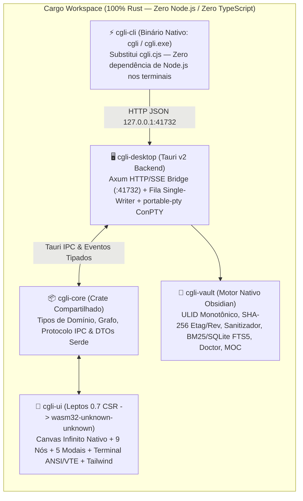

# Plano de Arquitetura e Implementação: Refatoração 100% Rust (CGLI Full-Stack Rust)

**Autor:** Planejador CGLI (Antigravity) · **Data:** 2026-11-10 · **Status:** Proposta para Aprovação  
**Escopo:** Migração integral de TypeScript/React/Node.js (~14.270 LOC JS/TS) para **100% Rust** (Workspace Cargo unificado), preservando rigorosamente **todas as funcionalidades** e **100% do design visual (Studio Clean n8n + Extensão VS Code)**.

---

## 1. Visão Arquitetural: Como atingir 100% Rust mantendo o Design Pixel-Perfect

Atualmente, o **CGLI** possui ~18.280 linhas de código divididas em três camadas heterogêneas:
1. **Core Desktop (`src-tauri/src/`, ~1.500 LOC Rust):** Gerenciador ConPTY (`portable-pty`), servidor TCP/HTTP Bridge manual e comandos IPC básicos.
2. **CLI & Motor de Memória Obsidian (`.cgli/bin/*.cjs` + `vite.config.ts`, ~3.070 LOC Node.js/CommonJS):** Scripts `cgli.cjs` e `vaultManager.cjs` invocados via `std::process::Command::new("node")` pelo Rust.
3. **Interface Gráfica (`src/`, ~11.200 LOC TypeScript/React 19):** Estado global em Zustand (`canvasStore.ts`), grafo infinito (`@xyflow/react`), 9 tipos de nós, 5 modais, emulador de terminal (`@xterm/xterm`) e estilização Tailwind CSS v4 (`src/index.css`).

### Decisão de Stack Frontend: **Tauri v2 + Leptos 0.7 (CSR/WASM) + Tailwind CSS**
Para eliminar 100% do TypeScript/React/Node.js **sem perder um único pixel do design atual**, a arquitetura alvo utiliza **Tauri v2 + Leptos (Rust compilado para WebAssembly via Trunk)** no frontend, aliado a um **Workspace Cargo multi-crate**:

> [!IMPORTANT]
> **Por que Tauri v2 + Leptos (WASM) em vez de GUI GPU imediata (egui/iced)?**
> 1. **Fidelidade Visual Absoluta (Mesmo Design):** Preserva a folha de estilos exata (`src/index.css`), variáveis CSS (`--canvas-bg`, `--accent-claude`, `--accent-agy`, etc.), classes utilitárias do Tailwind CSS, sombras, bordas arredondadas, backdrop-blur e animações.
> 2. **Suporte Nativo a Recursos Web Críticos do CGLI:**
>    - **`PreviewNode`:** Exige um `<iframe sandbox="allow-scripts">` real para renderizar protótipos HTML/JS gerados pelos agentes.
>    - **`ArtifactNode` (Comentários Ancorados por Trecho):** Utiliza a **CSS Custom Highlight API** (`CSS.highlights` / `::highlight(artifact-comment)`) e `Selection`/`Range` do DOM (`web-sys`).
>    - **`ImageAnnotationModal`:** Editor vetorial SVG interativo (`<svg viewBox="0 0 800 480">`) com rasterização em `<canvas>` 2D para exportação PNG Base64.
> 3. **Reatividade Fina (Fine-Grained Signals):** Sinais reativos (`RwSignal<T>`, `Memo<T>`) substituem o Zustand e o Virtual DOM do React, atualizando apenas os nós/arestas afetados durante pan/zoom a 60fps.



---

## 2. Estrutura do Novo Cargo Workspace

O repositório será organizado como um **Cargo Workspace** na raiz, eliminando `package.json`, `package-lock.json`, `node_modules`, `tsconfig*.json`, `vite.config.ts` e `.cgli/bin/*.cjs`:

```text
CGLI/
├── Cargo.toml                  # Workspace root: members = ["crates/*"]
├── Trunk.toml                  # Build tool Rust/WASM + Tailwind CSS CLI hook
├── index.html                  # Entrypoint minimalista para o binário WASM
├── styles/
│   └── index.css               # Design system idêntico ao atual (variáveis + temas claro/escuro)
└── crates/
    ├── cgli-core/              # Modelos compartilhados (Nodes, Edges, Project, Vault, IPC)
    ├── cgli-vault/             # Port 1:1 de vaultManager.cjs para Rust puro
    ├── cgli-cli/               # Port 1:1 de cgli.cjs para binário nativo (`cgli` / `cgli.exe`)
    ├── cgli-pty-vt/            # Parser ANSI/VT100 (`vte` / `alacritty_terminal`) compartilhável
    ├── cgli-ui/                # Frontend em Rust (Leptos + web-sys + lucide-leptos + pulldown-cmark)
    └── cgli-desktop/           # Tauri v2 Host (antigo src-tauri, Axum Bridge + portable-pty)
```

---

## 3. Mapeamento Completo de Funcionalidades (De → Para)

### 3.1 Backend, CLI & Memória Compartilhada (Eliminação do Node.js)

| Componente Atual | Linhas | Novo Crate / Módulo Rust | Crates & Implementação Técnica |
| :--- | :---: | :--- | :--- |
| `.cgli/bin/vaultManager.cjs` | 1.701 | `crates/cgli-vault` | `ulid` (Crockford Base32 monotônico 26 chars), `sha2` (etag 16 hex sobre o corpo), `regex` (`SECRET_PATTERNS`), `serde_yaml` (frontmatter), `rusqlite` com `fts5` (busca BM25 rápida), escrita atômica via `.tmp/*.part` + `File::sync_all()` + `fs::rename` com backoff exponencial. |
| `.cgli/bin/cgli.cjs` + `.cmd` | 783 | `crates/cgli-cli` (`cgli.exe` / `cgli`) | `clap` (derive) + `ureq` (HTTP cliente síncrono ultra-leve, binário < 2 MB, startup < 5ms). Suporta todos os subcomandos (`spawn-subagent`, `create-artifact`, `create-preview`, `create-diff`, `list-folders`, `status`, `memory *`) e spooler `.outbox` com política *Fail-Loud* (`std::process::exit(1)`). |
| `src-tauri/src/bridge/mod.rs` | 641 | `crates/cgli-desktop/src/bridge/` | Substitui o parser HTTP manual de buffer fixo (`[0u8; 16384]`) por **`axum` + `tokio`**, mantendo a porta `41732` (com fallback dinâmico), fila FIFO *Single-Writer* (`mpsc::UnboundedSender<WriteRequest>`) e execução direta em memória do `cgli-vault` (zero spawn de subprocesso Node!). |
| `vite.config.ts` (`ptyServerPlugin`) | 594 | *Removido (Unificado)* | Como o Axum Bridge e o `cgli-vault` rodam nativamente no `cgli-desktop`, não há mais duplicação de servidor em JS. |
| `src-tauri/src/pty/session.rs` | 477 | `crates/cgli-desktop/src/pty/` | Mantém `portable-pty` com ConPTY nativo, `drain_utf8`, `resolve_command` e detecção robusta em stream do marcador `<<<CGLI:ACTION JSON>>>` (com buffer de linha para marcadores fragmentados entre leituras). |
| `src-tauri/src/media/mod.rs` | 101 | `crates/cgli-desktop/src/media.rs` | Usa crate `base64` padrão + sanitização de caminho para `.cgli/attachments/`. |
| `src-tauri/src/workspace/mod.rs` | 183 | `crates/cgli-desktop/src/workspace.rs` | Persistência tipada de `.cgli/workspace.json` e leitura/escrita de `~/.cgli/skills/`. |

---

### 3.2 Estado Global & Canvas Engine (De React Flow + Zustand para Rust/WASM)

| Componente Atual | Linhas | Novo Módulo em `crates/cgli-ui` | Estratégia de Implementação em Rust |
| :--- | :---: | :--- | :--- |
| `src/types/canvas.ts` | 272 | `crates/cgli-core/src/types.rs` | Structs e Enums Rust (`#[derive(Serialize, Deserialize, Clone, PartialEq)]`): `ThemeMode`, `AgentType`, `AgentRole`, `AgentStatus`, `NodeKind` (enum tipado em vez de `any`), `ArtifactComment`, `AnnotationItem`, `StashItem`, `CliConfig`, `ProjectInfo`. |
| `src/store/canvasStore.ts` | 2.957 | `crates/cgli-ui/src/store/` | Dividido em 5 sub-módulos reativos (`RwSignal`):<br>1. `graph_store.rs` (nós, arestas, seleção, grupos, colisão/overlap > 25%, drag-to-attach)<br>2. `agent_store.rs` (aprovação de artefatos, injeção de contexto `.cgli/context/<id>.md`, bridge listener)<br>3. `project_store.rs` (workspaces, multi-pastas, auto-save em `localStorage` + `save_workspace` Tauri)<br>4. `stash_store.rs` (arquivamento e restauração 1-clique)<br>5. `settings_store.rs` (CLIs, papéis planner/executor, skills). |
| `@xyflow/react` (`src/App.tsx`) | 747 | `crates/cgli-ui/src/canvas/` | **Motor de Canvas Infinito Nativo em Leptos:**<br>- `ViewportTransform { x, y, zoom }` com pan (mouse drag / middle click) e zoom centrado no cursor (wheel `0.15x` a `2.5x`).<br>- Camada de fundo SVG com padrão de pontos (`BackgroundVariant.Dots`, `--canvas-dot`).<br>- Camada SVG de arestas (`RemovableEdge` com curvas Cubic Bezier calculadas em Rust e botão central `×`).<br>- Camada DOM transformada (`transform: translate(Xpx, Ypx) scale(Z)`) para os cards dos nós, com `NodeResizer` nos 4 cantos/bordas e `Handle`s (`Left`/`Right` 14x14px com hit-zone de +12px).<br>- `MiniMap` reativo no canto inferior direito e `Controls` (Zoom In, Zoom Out, Fit View) no canto inferior esquerdo.<br>- Menu de contexto (`oncontextmenu`) e colagem global `Ctrl+V` mapeando `screen_to_flow_position`. |

---

### 3.3 Os 9 Nós Customizados, Emulador de Terminal e Modais (Paridade Visual 1:1)

1. **`AgentCardNode` (`crates/cgli-ui/src/nodes/agent_card.rs` — ref. `AgentCardNode.tsx`, 949 LOC):**
   - Mesmas cores de acento (`#EA580C` Claude Code, `#0284C7` AGY, `#6366F1` custom).
   - **Modo Híbrido (Dual-View):** Alternância instantânea entre a aba **Extensão** (chat rico Markdown, *Thinking Accordion* colapsável, cards de aprovação de comando/diff com `[✓ Aprovar]` / `[✕ Rejeitar]`, gaveta de planos aprovados e badges de imagens/artefatos anexados) e a aba **Terminal**.
   - **Terminal Nativo em Rust/WASM (`crates/cgli-pty-vt`):** Emulador de terminal baseado em `alacritty_terminal` (ou `vt100` + renderizador Canvas/DOM de alta performance em Rust/WASM) com suporte completo a cores ANSI 24-bit, cursores, scrollback, seleção, `FitAddon` via `ResizeObserver` (`web-sys`) disparando `resize_pty(cols, rows)`, e temas idênticos (`TERMINAL_THEMES.dark` `#0D1117` e `TERMINAL_THEMES.light` `#F8FAFC`).
   - Persistência de sessão de CLI (`--session-id` / `--resume` para Claude; `--conversation` / `--continue` para AGY).

2. **`ArtifactNode` (`crates/cgli-ui/src/nodes/artifact.rs` — ref. `ArtifactNode.tsx`, 587 LOC + `textAnchors.ts`, 140 LOC):**
   - 3 abas: **Documento**, **Comentários (N)** e **Dividido (Lado a Lado)**.
   - Renderização Markdown GFM em Rust via `pulldown-cmark` + realce de sintaxe via `syntect` + alertas GitHub (`[!IMPORTANT]`, `[!NOTE]`, `[!TIP]`, `[!WARNING]`, `[!CAUTION]`).
   - **Comentários Ancorados por Trecho:** Port direto de `utils/textAnchors.ts` para `web-sys` (`window().get_selection()`, `Range`, `TreeWalker`, `CSS.highlights` com `::highlight(artifact-comment)`, `::highlight(artifact-comment-active)` e `::highlight(artifact-comment-pending)`), botão flutuante `"Comentar"` sobre a seleção e scroll sincronizado entre documento e lista de comentários.
   - Botão **"Aprovar e Executar"** que injeta o plano + comentários estruturados diretamente no PTY do agente conectado.

3. **`TerminalNode` (`crates/cgli-ui/src/nodes/terminal.rs` — ref. `TerminalNode.tsx`, 293 LOC):**
   - Card dedicado do **PowerShell** com tema clássico azul (`#012456` Campbell ANSI palette), cabeçalho `#0078D4`, proteção de janela de saída obsoleta (`STALE_EXIT_WINDOW_MS = 1500ms`), botões Limpar, Reiniciar, Encerrar e Excluir.

4. **`ImageNode` & `ImageGroupNode` (`crates/cgli-ui/src/nodes/image.rs` & `image_group.rs` — ref. 1.053 LOC):**
   - Colagem direta no canvas (`Ctrl+V` lendo `ClipboardEvent.clipboardData.items` via `web-sys`), upload por clique/drag-and-drop, carrossel de múltiplas imagens, miniaturas, sobreposição SVG das anotações vetoriais e envio automático do caminho físico (`.cgli/attachments/...`) para o agente conectado.

5. **`GroupNode` (`crates/cgli-ui/src/nodes/group.rs` — ref. `GroupNode.tsx`, 397 LOC):**
   - Container visual com 6 cores selecionáveis, modo **Reativo** (propaga contexto automaticamente entre membros do grupo), cálculo de bounding-box automático e highlight ao arrastar nós sobre o grupo.

6. **`MemoryNode` (`crates/cgli-ui/src/nodes/memory.rs` — ref. `MemoryNode.tsx`, 209 LOC):**
   - Card de nota do Obsidian com cores por tipo (`decision`, `knowledge`, `learning`, `rule`, `task`, `entity`, `journal`), badge de escopo (`Local` / `Global`), tags e **Drag-to-Attach** (conecta automaticamente ao soltar sobre um `AgentCardNode`).

7. **`PreviewNode` & `DiffNode` (`crates/cgli-ui/src/nodes/preview.rs` & `diff.rs` — ref. 377 LOC):**
   - `PreviewNode`: `<iframe sandbox="allow-scripts allow-forms" srcdoc=...>` com reload e modo tela cheia.
   - `DiffNode`: Parser de unified diff em Rust (`similar` / parser próprio) exibindo linhas adicionadas (verde), removidas (vermelho), numeração dupla de linhas (`oldLine`/`newLine`) e contadores `+N / -M`.

8. **Topbar, StashDrawer e 5 Modais (`crates/cgli-ui/src/modals/` & `layout/`):**
   - `Topbar`: Seletor de projetos, botão `+ Novo Nó`, abrir explorador de memória, abrir gaveta Stash com contador, Fit View, alternador de tema Claro/Escuro e botão Configurações.
   - `StashDrawer`: Gaveta lateral retrátil à direita com filtro, preview e restauração com 1 clique.
   - `ImageAnnotationModal`: Editor SVG 800x480 (`circle`, `arrow`, `rect`, `brush`, `text`), seletor de cores (`#EF4444`, `#F59E0B`, `#10B981`, `#3B82F6`), desfazer, limpar e rasterização via `HtmlCanvasElement` para salvar PNG anotado.
   - `MemoryExplorerModal`: Abas Notas / Mapa de Conteúdo (MOC) / Memory Doctor, busca instantânea, filtro por tipo e escopo, botão Compactar Journals e botão "Enviar para o Canvas".
   - `SettingsModal`, `NewProjectModal`, `ManageWorkspaceModal`: Paridade integral com as telas atuais.

---

## 4. Fases de Execução (Roadmap Incremental sem Quebra)

A migração foi desenhada em **6 Fases Sequenciais** para que o projeto permaneça compilável e testável a cada entrega:

| Fase | Escopo | Entregáveis Principais | Critério de Aceite |
| :---: | :--- | :--- | :--- |
| **Fase 1** | **Fundação Cargo Workspace & `cgli-core`** | Reorganização em workspace Cargo; criação de `cgli-core` com todos os tipos de `src/types/canvas.ts` traduzidos para structs/enums Rust com testes de serialização compatíveis com o `workspace.json` atual. | `cargo test --workspace` passa 100%; compatibilidade retroativa com `.cgli/workspace.json` existente. |
| **Fase 2** | **Motor de Memória Nativo (`cgli-vault`) & CLI (`cgli-cli`)** | Port completo de `vaultManager.cjs` (1.701 LOC) para `crates/cgli-vault` e de `cgli.cjs` (778 LOC) para o binário nativo `crates/cgli-cli` (`cgli` / `cgli.exe`). Eliminação de `node` nos wrappers `.cgli/bin/cgli*`. | Todos os comandos `cgli status`, `cgli list-folders`, `cgli create-*`, `cgli spawn-subagent` e `cgli memory *` executam como binário Rust nativo sem Node.js instalado. |
| **Fase 3** | **Refatoração do Backend Tauri (`cgli-desktop`)** | Substituição do servidor TCP manual em `bridge/mod.rs` por **Axum**; integração direta com `cgli-vault` em memória + fila FIFO *Single-Writer*; correção do parser de stream markers `<<<CGLI:...>>>` no PTY. | `cargo test -p cgli-desktop`; endpoints `/api/*` e `/api/memory/*` respondem em < 2ms sem invocar subprocessos Node. |
| **Fase 4** | **Shell Frontend Leptos (WASM), Store Reativo & Canvas Engine** | Configuração do `Trunk.toml` + `crates/cgli-ui`; port do `src/index.css`; implementação do Store reativo (`RwSignal`) e do motor de Canvas Infinito (Viewport pan/zoom, grid de pontos, `RemovableEdge`, `MiniMap`, `Controls`, colisão de grupos e Drag-to-Attach). | Canvas renderiza em 60fps no WebView2 do Tauri com temas Claro/Escuro, zoom/pan suaves, criação/conexão/exclusão de nós e arestas. |
| **Fase 5** | **Port dos 9 Nós Customizados & Emulador de Terminal Rust** | Implementação de `crates/cgli-pty-vt` (ANSI/VT100 + Fit resize) e dos 9 nós: `AgentCardNode`, `ArtifactNode` (com `textAnchors` via `web-sys` + CSS Highlights), `TerminalNode`, `ImageNode`, `ImageGroupNode`, `GroupNode`, `MemoryNode`, `PreviewNode` e `DiffNode`. | Paridade visual e funcional 1:1 em todos os 9 nós; sessões interativas de Claude Code, AGY e PowerShell funcionando no ConPTY. |
| **Fase 6** | **Port dos 5 Modais, Topbar, StashDrawer & Limpeza Final** | Implementação de `Topbar`, `StashDrawer`, `ImageAnnotationModal`, `MemoryExplorerModal`, `SettingsModal`, `NewProjectModal` e `ManageWorkspaceModal`; remoção definitiva de `package.json`, `node_modules`, `vite.config.ts` e `src/*.tsx`. | 100% do código do repositório é Rust (`*.rs`) + CSS (`index.css`); `cargo build --release` gera o instalador Tauri e o binário `cgli` sem dependência de Node.js. |

---

## 5. Estratégia de Verificação e Testes

1. **Testes Unitários e de Integração em Rust (`cargo test --workspace`):**
   - `cgli-core`: Round-trip JSON de `workspace.json` reais gerados pela versão React para garantir **zero perda de dados** dos projetos salvos pelo usuário.
   - `cgli-vault`: Testes de monotonicidade de ULID no mesmo milissegundo, detecção e redação de `SECRET_PATTERNS`, concorrência otimista (`409 Conflict` e geração de `.conflict-*`), compactação de journals, geração de MOC e diagnóstico do Doctor.
   - `cgli-desktop`: Testes dos endpoints Axum (`/api/spawn-subagent`, `/api/create-artifact`, `/api/memory/*`), drenagem de `.outbox` na inicialização e extração de `<<<CGLI:...>>>` fragmentados no PTY.
2. **Validação de Fidelidade Visual (Design Parity Check):**
   - Comparação lado a lado (Dark Mode `#06090E` e Light Mode `#EEF2F6`) de cada um dos 9 nós, Topbar, StashDrawer e 5 modais.
3. **Fluxo E2E Real no Tauri Desktop:**
   - Abrir nó Claude Code (Planejador) → gerar plano com `cgli create-artifact` → adicionar comentários ancorados por trecho no `ArtifactNode` → clicar em **"Aprovar e Executar"** → validar injeção automática no nó AGY (Executor) e criação de `DiffNode` e `MemoryNode`.
